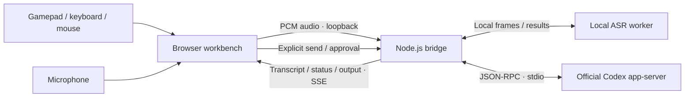

<p align="center">
  
</p>

<h1 align="center">Codex Controller</h1>

<p align="center">
  <strong>Drive Codex with a gamepad.</strong><br>
  Navigate with your thumbs. Speak your next task. Review before you send.
</p>

<p align="center">
  <a href="LICENSE"></a>
  <a href="package.json"></a>
  <a href="#development"></a>
  <a href="https://github.com/HUAYUE1024/codex-controller/stargazers"></a>
</p>

<p align="center">
  English · <a href="README.zh-CN.md">简体中文</a><br>
  <a href="#quick-start">Quick start</a> · <a href="#the-controls">Controls</a> · <a href="#local-voice">Local voice</a> · <a href="#contributing">Contribute</a>
</p>


<p align="center"><sub>Actual application UI with isolated synthetic demo data. The current interface is in Chinese; no live account, session or recording is shown.</sub></p>

## Why this exists

Coding agents made it easier to describe work. Their interfaces still mostly expect a keyboard and mouse.

**Codex Controller explores another input model:** a gamepad for navigation, local speech recognition for drafting, and explicit confirmation for actions. It is a Windows-first browser workbench connected to the official Codex CLI—not a mouse macro, an IDE replacement or an official OpenAI product.

| Capability | What you can do |
| --- | --- |
| Spatial navigation | Move between visible controls with the left stick; use the right stick to read messages, code and tables. |
| ABXY desktop controls | Confirm, go back, open an on-screen keyboard, or switch to a precise in-page pointer. |
| Continuous voice drafting | Tap RT to start, pause naturally, continue speaking, then tap again to finish. Text stays in the draft until you send it. |
| Intent wheel | Choose from eight editable prompt intents, including debugging, UI polish, testing and review. These are draft templates—not hidden automation. |
| Controller Studio | Inspect 17 standard-layout buttons, trigger values and stick coordinates; remap actions and tune thresholds, dead zones and scroll speed. |
| Execution visibility | Read streamed replies, available reasoning summaries, commands, file changes and approval requests in one timeline. |

<table>
  <tr>
    <td width="50%"></td>
    <td width="50%"></td>
  </tr>
  <tr>
    <td align="center"><sub>A workspace for tasks, drafts and execution records.</sub></td>
    <td align="center"><sub>Choose an intention. Inspect the prompt. Keep control.</sub></td>
  </tr>
</table>

## Quick start

Start with keyboard and mouse. Add a controller and local voice when you are ready.

### Requirements

| Component | Requirement |
| --- | --- |
| Platform | Windows; the current hardware-verified environment. Other operating systems have not been validated. |
| Runtime | [Node.js 22+](https://nodejs.org/) and Git. The workbench has no third-party npm dependencies. |
| Agent | [Official Codex CLI](https://github.com/openai/codex), available on `PATH`, with an account that can use Codex. |
| Browser | Gamepad API support; microphone permission, WebAudio and AudioWorklet for voice. |
| Optional hardware | A standard-mapped USB/Bluetooth gamepad and a microphone. |

Install the CLI if it is not already available:

```powershell
npm install -g @openai/codex
```

Clone and launch:

```powershell
git clone https://github.com/HUAYUE1024/codex-controller.git
cd codex-controller
.\start.cmd
```

1. Enter the **existing project directory** you want Codex to work in when the launcher asks.
2. Open the printed address, normally `http://127.0.0.1:4318/`.
3. Sign in through the official authorization flow if needed. Select or create a task.
4. Draft a request, check the target and text, then select **Send**. Review approvals when requested.

The launcher builds the frontend before starting. Keep its terminal open; press `Ctrl+C` there to stop the server. There is no separate API key to configure for the Codex account flow; account limits and model usage still apply.

For an explicit workspace, environment variables, diagnostics and the full acceptance checklist, see the [usage guide (Chinese)](docs/USAGE.zh-CN.md).

## The controls

Connect your gamepad, focus the page and press a button so the browser can discover it. Defaults follow the **Gamepad API standard layout**; labels and availability can vary by device.

| Input | Default interaction |
| --- | --- |
| Left stick | Spatial focus navigation; move the in-page pointer in pointer mode. |
| Right stick | Variable-speed vertical reading and horizontal code/table scrolling. |
| **A** | Confirm the focused control or click the pointer target. Focusing a text field does not send it. |
| **B** | Back out of the current layer without deleting the draft. |
| **X** | Open or close the on-screen keyboard for the active text field. |
| **Y** | Switch between spatial focus and the in-page pointer. |
| **RT** | Tap to start continuous voice; tap again to stop. No holding required. |
| **LT + left stick** | Hold LT, select an intent, then release to append its prompt to the draft. Center the stick or press B to cancel. |
| LB / RB | Previous / next task. Drafts are retained per task in the page session. |
| View / Start | Task overview / new-task dialog. |
| L3 / R3 | Focus layout / reading-position anchor. |
| D-pad | Jump between records, expand details, or navigate controls inside dialogs. |

Open **Controller Studio** from the header to remap buttons and adjust sensitivity. Settings stay in the current browser. Non-standard devices display raw input but do not execute workspace shortcuts. The pointer is confined to this webpage, not the operating system desktop.

Keyboard and mouse remain first-class: use Tab, Shift+Tab, Enter and Space normally; `Alt+K` toggles the screen keyboard and `Alt+M` toggles the in-page pointer.

## Local voice

The default voice path uses **Fun-ASR-Nano + Silero VAD on your machine**, rather than the browser's online speech-recognition service. The current integration targets Chinese dictation.

- Tap RT, speak, pause, and continue. Silence between utterances does not clear the transcript or end the whole recording.
- Interim text can be corrected by the final utterance result. Review names, technical terms and mixed-language text before sending.
- Each session lasts up to **3 minutes**. Stop releases the microphone immediately while the last utterance finishes.
- Select the actual microphone in **Voice diagnostics** and inspect its live input level. An open microphone is not proof of audible input.
- The application does not write raw audio to disk. Audio goes to the same-machine bridge; **sending the draft to Codex is a separate action**.

### Optional setup for a fresh clone

Use Python 3.12 and a separate virtual environment. Install a matching `torch` / `torchaudio` pair for your platform; choose the appropriate CPU/CUDA build using the [official PyTorch selector](https://pytorch.org/get-started/locally/).

```powershell
python -m venv .venv
.\.venv\Scripts\python.exe -m pip install torch torchaudio
.\.venv\Scripts\python.exe -m pip install "transformers==5.17.0" numpy huggingface_hub
.\.venv\Scripts\python.exe scripts/setup-voice.py
```

Restart the workbench after setup. The installer downloads about **1.66 GB of ASR weights plus 2.3 MB of VAD weights**, pins revisions, verifies SHA-256 hashes and records the selected Python executable. Installation needs network access; runtime inference uses local files with remote model code disabled. CUDA is selected when available, otherwise CPU. CPU latency and recognition quality depend on your hardware and speech.

This setup recipe is not a fresh-machine certification. One Windows laptop has been checked with a Realtek microphone, real draft input and pause/resume; the detailed tested environment and limits are in the [usage guide](docs/USAGE.zh-CN.md#语音输入). The [upstream model card](https://huggingface.co/FunAudioLLM/Fun-ASR-Nano-2512-hf) documents the native Transformers integration and its own verification scope.

## How it works



The bridge starts a separate `codex app-server --stdio` process using the CLI's account and session facilities. Visibility of sessions created by another client depends on the shared Codex data directory. Speech recognition is local after setup; **Codex model requests are not an offline inference feature**.

The server is intended for loopback use. Do not expose it through public ports or tunnels. Codex may execute commands and change files according to its configured sandbox and approval policy; not every action necessarily produces a new approval dialog. Available reasoning summaries are displayed as supplied—no synthetic private reasoning is generated.

## Development

```powershell
npm run build   # Validate source and regenerate the browser bundle
npm test        # Build, then run the existing Node test suite
npm run smoke   # Read-only handshake with an installed Codex CLI
```

Edit `src/`, not the generated `public/app.js`. The build uses Node's standard library and preserves the previous bundle if validation fails.

| Path | Responsibility |
| --- | --- |
| [`src/controller-pilot.js`](src/controller-pilot.js) | Spatial navigation, pointer, screen keyboard, scrolling and intent wheel. |
| [`src/gamepad-controls.js`](src/gamepad-controls.js) | Controller visualization, remapping and tuning. |
| [`src/voice-input.js`](src/voice-input.js), [`src/local-recognition.js`](src/local-recognition.js) | Recording lifecycle, draft updates and local audio transport. |
| [`src/activity-view.js`](src/activity-view.js), [`src/app.js`](src/app.js) | Execution timeline and application coordination. |
| [`server.mjs`](server.mjs) | Loopback HTTP/SSE bridge and Codex RPC lifecycle. |
| [`scripts/`](scripts/) | Build, startup, model setup and local speech worker. |
| [`tests/`](tests/) | Isolated UI/protocol regressions, audio boundaries and local-engine checks. |

Tests cover controller gating, draft lifecycle, stale events, permissions and audio transport. Real-model tests explicitly skip when the local model/runtime is absent. Synthetic audio regression results are not an accuracy benchmark, and DOM fixtures do not certify physical controller behavior.

## Project status

**Experimental, Windows-first, Chinese UI.** This is a working local workbench, not a hosted service or a production-readiness claim.

Next areas for contributions:

- Controller compatibility reports and tested device presets.
- More reproducible fresh-machine voice setup and representative speech evaluation.
- Interface localization and broader hardware/accessibility testing.

## Contributing

Concrete feedback is especially valuable: include your browser, controller model/mapping, Node/Codex versions, reproduction steps, and expected versus actual behavior. For voice issues, add the selected microphone, input level and engine status; remove private transcripts and paths before sharing.

Use [Issues](https://github.com/HUAYUE1024/codex-controller/issues) for reproducible bugs or focused ideas. For a pull request, keep the change small, edit source rather than the generated bundle, run `npm test`, and distinguish automated checks from hardware testing. Discuss large behavior changes in an issue first.

If this interaction model is useful to you, **star the repository** to help others discover it. Device reports, thoughtful issues and small fixes are just as welcome.

## License and acknowledgments

Project code is released under the [MIT License](LICENSE). Downloaded models and third-party dependencies retain their own licenses and are not bundled in this repository.

Built on the [official Codex CLI](https://github.com/openai/codex), [Fun-ASR-Nano](https://huggingface.co/FunAudioLLM/Fun-ASR-Nano-2512-hf) and [Silero VAD](https://github.com/snakers4/silero-vad). Input-layer ideas draw on [Steam Input's keyboard and mouse bindings](https://partner.steamgames.com/doc/features/steam_controller/legacy_mode?language=english); Steam is not a runtime dependency. This is an independent project, not affiliated with or endorsed by OpenAI or Valve.
