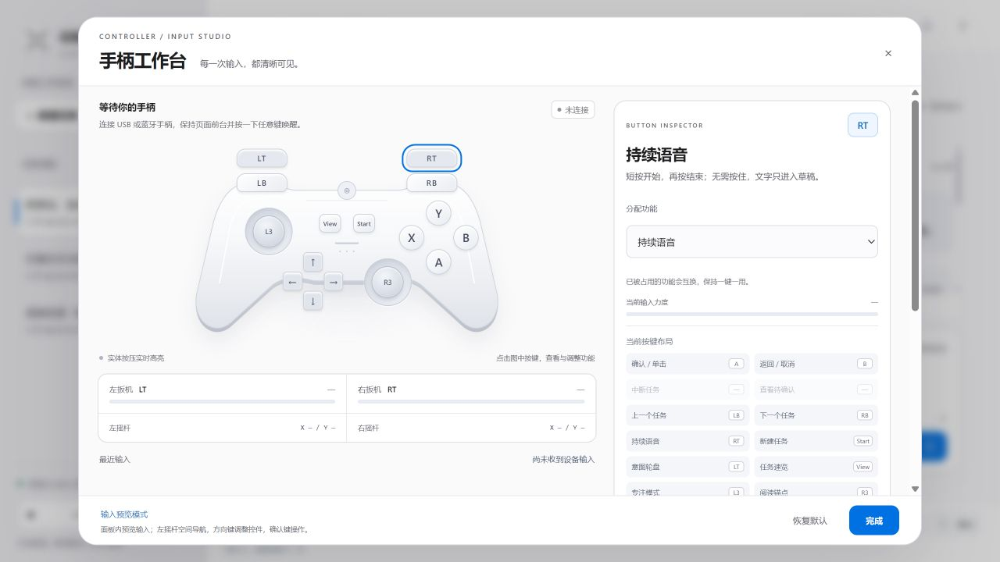
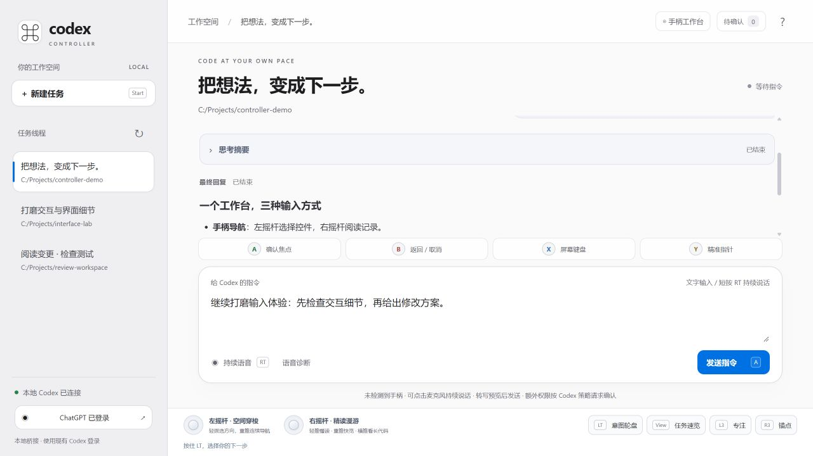
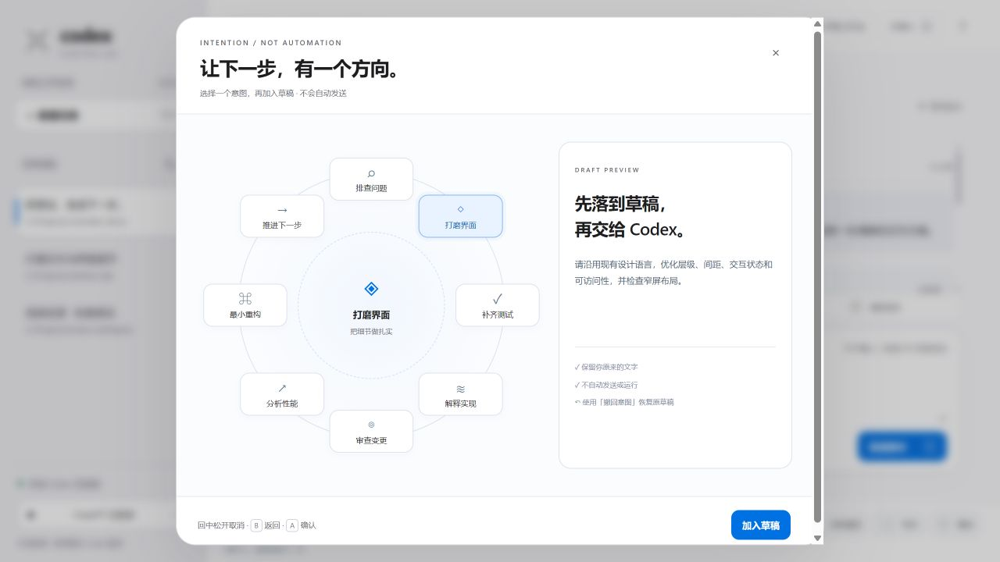
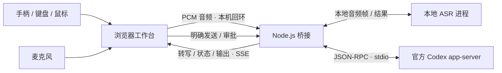

<p align="center">
  
</p>

<h1 align="center">Codex Controller</h1>

<p align="center">
  <strong>让手柄成为 Codex 的另一种工作方式。</strong><br>
  用摇杆导航，用语音整理想法，确认之后再执行。
</p>

<p align="center">
  <a href="LICENSE"></a>
  <a href="package.json"></a>
  <a href="#开发与验证"></a>
  <a href="https://github.com/HUAYUE1024/codex-controller/stargazers"></a>
</p>

<p align="center">
  <a href="README.md">English</a> · 简体中文<br>
  <a href="#快速开始">快速开始</a> · <a href="#手柄交互">手柄交互</a> · <a href="#本地语音">本地语音</a> · <a href="#参与贡献">参与贡献</a>
</p>



<p align="center"><sub>截图来自真实应用界面，使用隔离的合成示例数据；不包含真实账号、任务会话或录音。当前界面为中文。</sub></p>

## 为什么做这个项目

编程 Agent 让“描述工作”变得更容易，但大多数交互仍然围绕键盘和鼠标展开。

**Codex Controller 尝试另一种输入方式**：手柄负责导航，本地语音负责起草，明确确认负责提交。它是面向 Windows 的浏览器工作台，通过本机桥接官方 Codex CLI；不是鼠标宏、完整 IDE，也不是 OpenAI 官方产品。

| 能力 | 实际体验 |
| --- | --- |
| 双摇杆导航 | 左摇杆按屏幕方位寻找控件；右摇杆控制阅读速度，也能横向浏览代码与表格。 |
| ABXY 键鼠协作 | 确认、返回、屏幕键盘、页面指针各有职责，随时接续实体键鼠。 |
| 持续语音草稿 | 短按 RT 开始，再按结束；停顿不清空转写，文字先进入草稿。 |
| 八向意图轮盘 | 选择排错、界面打磨、测试、审查等可编辑模板；不是后台自动执行。 |
| 可调手柄工作台 | 查看标准布局的 17 个按键、扳机力度和摇杆坐标；调整分配、阈值、死区及滚动速度。 |
| 清晰执行记录 | 在同一时间线查看流式回复、服务端提供的思考摘要、命令、文件变更和审批请求。 |

<table>
  <tr>
    <td width="50%"></td>
    <td width="50%"></td>
  </tr>
  <tr>
    <td align="center"><sub>任务、草稿与执行过程，放在一个工作区。</sub></td>
    <td align="center"><sub>先选择意图，再检查提示词，始终由你确认。</sub></td>
  </tr>
</table>

## 快速开始

可以先用键盘和鼠标启动，再逐步接入手柄与本地语音。

### 环境要求

| 组件 | 要求 |
| --- | --- |
| 系统 | Windows，当前已进行硬件验证的平台；其他操作系统尚未验证。 |
| 运行时 | [Node.js 22+](https://nodejs.org/) 与 Git；工作台本身没有第三方 npm 依赖。 |
| Agent | 已加入 `PATH` 的[官方 Codex CLI](https://github.com/openai/codex)，以及可使用 Codex 的账号。 |
| 浏览器 | 支持 Gamepad API；语音另需麦克风权限、WebAudio 与 AudioWorklet。 |
| 可选设备 | 标准映射的 USB / 蓝牙手柄、麦克风。 |

尚未安装 Codex CLI 时，先执行：

```powershell
npm install -g @openai/codex
```

克隆并启动：

```powershell
git clone https://github.com/HUAYUE1024/codex-controller.git
cd codex-controller
.\start.cmd
```

1. 按启动器提示填写 **Codex 要操作的现有项目目录**。
2. 打开终端打印的本机地址，通常为 `http://127.0.0.1:4318/`。
3. 如需登录，在官方授权页面完成；返回后选择或创建任务。
4. 输入要求，核对目标任务和草稿，再选择发送；出现审批时检查内容并决定。

启动器会先构建前端。保持终端打开，在该终端按 `Ctrl+C` 结束服务。Codex 账号流程不要求另配 API key，但仍受账号额度与模型使用规则约束。

指定工作目录、环境变量、诊断与验收清单见[完整使用与排错指南](docs/USAGE.zh-CN.md)。

## 手柄交互

连接手柄、聚焦页面，再按一下按键让浏览器发现设备。默认映射遵循 **Gamepad API 标准布局**，不同设备的标签与可用输入可能不同。

| 输入 | 默认交互 |
| --- | --- |
| 左摇杆 | 空间焦点导航；指针模式下控制页面光标。 |
| 右摇杆 | 轻推细读、重推快览；横向浏览长代码与表格。 |
| **A** | 确认焦点或单击指针目标；输入框只聚焦，选中发送按钮后才发送。 |
| **B** | 逐层返回或取消，不删除草稿。 |
| **X** | 打开 / 收起当前文本框的屏幕键盘。 |
| **Y** | 切换空间焦点与精准页面指针。 |
| **RT** | 短按开始持续语音，再按结束，无需按住。 |
| **LT + 左摇杆** | 按住 LT 选择意图，松开追加到草稿；回中或 B 取消。 |
| LB / RB | 上一个 / 下一个任务；本页会话内按任务保留草稿。 |
| View / Start | 任务速览 / 新任务窗口。 |
| L3 / R3 | 专注布局 / 阅读位置锚点。 |
| 方向键 | 跳转记录、收展详情；在窗口内导航与调整控件。 |

从页头打开“手柄工作台”调整分配与灵敏度，设置只保存在当前浏览器。非标准映射设备只展示原始输入，不执行工作快捷键。页面指针不会移动系统鼠标。

键鼠可以随时接续：Tab / Shift+Tab 导航，Enter / Space 确认；`Alt+K` 切换屏幕键盘，`Alt+M` 切换页面指针。

## 本地语音

默认通道使用本机 **Fun-ASR-Nano + Silero VAD**，不依赖浏览器在线语音识别服务。当前集成面向中文口述。

- 短按 RT 开始，说话、停顿后接着说；句间静音不会清空转写或结束整段收音。
- 临时文字会被后续整句结果修正；专有名词、技术词汇和混说内容仍需核对。
- 每段最多 **3 分钟**；结束时立即释放麦克风，再等待尾句完成。
- 在“语音诊断”选择实际讲话的麦克风，观察实时电平；打开麦克风不等于收到有效声音。
- 应用不把原始音频写入磁盘，音频只送至同机桥接服务；**把草稿发送给 Codex 是独立操作**。

### 新克隆项目的可选安装

使用 Python 3.12，创建独立环境。`torch` / `torchaudio` 必须匹配；GPU 环境请通过 [PyTorch 官方选择器](https://pytorch.org/get-started/locally/)选用合适的 CPU / CUDA 构建。

```powershell
python -m venv .venv
.\.venv\Scripts\python.exe -m pip install torch torchaudio
.\.venv\Scripts\python.exe -m pip install "transformers==5.17.0" numpy huggingface_hub
.\.venv\Scripts\python.exe scripts/setup-voice.py
```

完成后重新启动工作台。安装器下载约 **1.66 GB ASR 权重和 2.3 MB VAD 权重**，固定修订、校验 SHA-256，并记录选用的 Python 路径。安装阶段需要网络；推理阶段仅使用本地文件，并关闭远程模型代码。可用时使用 CUDA，否则使用 CPU；CPU 延迟及识别效果取决于设备与语音条件。

上述命令是新环境安装路径，不代表所有新机器均已验收。本项目已在一台 Windows 笔记本上验证 Realtek 麦克风写入草稿、停顿续说；具体环境和局限见[语音安装详情](docs/USAGE.zh-CN.md#语音输入)。[上游模型卡](https://huggingface.co/FunAudioLLM/Fun-ASR-Nano-2512-hf)记录了原生 Transformers 集成与其自身验证范围。

## 工作原理



桥接启动独立的 `codex app-server --stdio` 进程，沿用 CLI 的账号与会话能力。能否看到其他客户端创建的会话，取决于是否共享 Codex 数据目录。语音在安装后本地推理，**不代表 Codex 模型请求也离线运行**。

服务面向本机回环使用，不应开放公网端口或公开隧道。Codex 根据沙箱与审批策略执行命令、修改文件，不是每个操作都会再次弹窗确认。思考区只展示服务端实际提供的摘要，不生成虚构的内部推理。

## 开发与验证

```powershell
npm run build   # 验证源码，重新生成浏览器脚本
npm test        # 构建后运行现有 Node 测试
npm run smoke   # 与已安装 Codex CLI 做只读握手
```

编辑 `src/`，不要直接修改生成的 `public/app.js`。构建使用 Node 标准库，校验失败保留旧脚本。

| 路径 | 职责 |
| --- | --- |
| [`src/controller-pilot.js`](src/controller-pilot.js) | 空间导航、页面指针、屏幕键盘、滚动与意图轮盘。 |
| [`src/gamepad-controls.js`](src/gamepad-controls.js) | 手柄可视化、重映射与调校。 |
| [`src/voice-input.js`](src/voice-input.js)、[`src/local-recognition.js`](src/local-recognition.js) | 收音生命周期、草稿更新与本地音频传输。 |
| [`src/activity-view.js`](src/activity-view.js)、[`src/app.js`](src/app.js) | 执行时间线与页面协调。 |
| [`server.mjs`](server.mjs) | 本机 HTTP / SSE 桥接与 Codex RPC 生命周期。 |
| [`scripts/`](scripts/) | 构建、启动、模型安装与本地语音进程。 |
| [`tests/`](tests/) | 隔离 UI / 协议回归、音频边界及本地引擎检查。 |

测试覆盖手柄门控、草稿生命周期、过期事件、权限与音频传输。缺少本地模型或运行库时，真实引擎测试明确跳过。合成音频回归不等于准确率基准，DOM 夹具测试不等于实体手柄验收。

## 项目状态

**实验阶段，Windows 优先，中文界面。** 当前提供可运行的本地工作台，不提供托管服务，也不声称已达到生产级成熟度。

欢迎一起推进：

- 更多手柄兼容性报告与经过验证的设备预设。
- 更可复现的新机器语音安装流程与代表性语音评测。
- 界面本地化，以及更多硬件和可访问性测试。

## 参与贡献

高质量反馈比笼统评价更有帮助：请包含浏览器、手柄型号与映射、Node / Codex 版本、复现步骤、预期与实际结果。语音问题请补充所选麦克风、输入电平和引擎状态，并在分享前移除私人转写及路径。

可通过 [Issues](https://github.com/HUAYUE1024/codex-controller/issues)提交可复现的问题或聚焦的想法。PR 请保持改动小而明确，修改源码而非仅修改生成脚本，运行 `npm test`，并区分自动化验证与硬件实测。较大的交互变更请先开 Issue 讨论。

如果你也认可这种交互方式，欢迎 **Star**，让更多人发现它。设备反馈、认真描述的问题和小而扎实的修复，同样重要。

## 许可证与致谢

项目代码采用 [MIT 许可证](LICENSE)。下载的模型与第三方依赖遵循各自许可证，不随仓库分发。

基于[官方 Codex CLI](https://github.com/openai/codex)、[Fun-ASR-Nano](https://huggingface.co/FunAudioLLM/Fun-ASR-Nano-2512-hf)与 [Silero VAD](https://github.com/snakers4/silero-vad)构建。输入层设计参考 [Steam Input 的键鼠绑定](https://partner.steamgames.com/doc/features/steam_controller/legacy_mode?language=english)，运行无需 Steam。本项目独立开发，未获 OpenAI 或 Valve 官方背书，也不隶属于它们。
